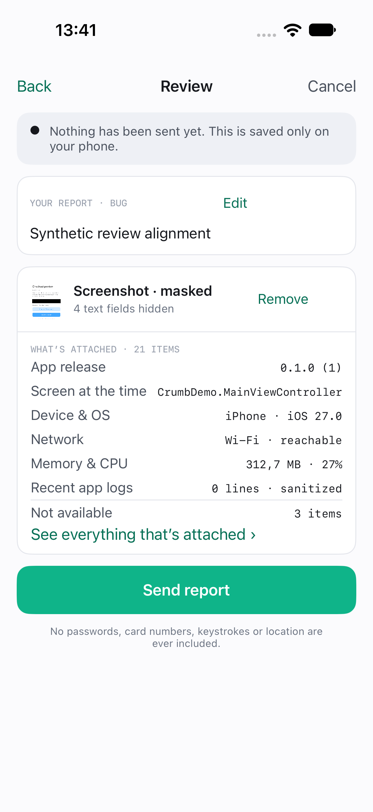
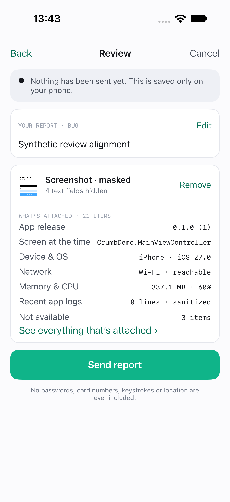

# Review action alignment evidence

Synthetic public demo fixtures for issue #63. Both images use the same disposable iPhone 18 Pro simulator on iOS 27.0 and the same synthetic description. The masked thumbnail is the local SDK demo, not a customer application.

| Before | After |
| --- | --- |
|  |  |

The buttons previously absorbed spare row width and centered their titles. The fix keeps each action at its intrinsic width and aligns its title to the trailing edge; the descriptive labels take the flexible space.

To reproduce: open the local demo reporter, enter a synthetic description, dismiss the keyboard, and open Review. Compare both action titles with the right card insets. The captures use an ephemeral XCTest navigation harness; no customer data, credentials, or live upload configuration was used.

The installed Xcode 27.1 SDK requires a scene lifecycle when running on iOS 27. An uncommitted scene-compatible demo adapter was used for both captures; it only creates the host demo window. The SDK UI in the before image is main at ea30ac5 and the after image adds only the alignment change. The adapter and capture harness are excluded from this PR.
