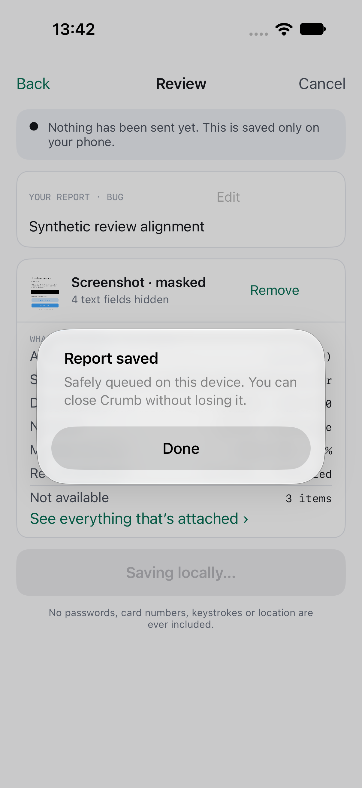
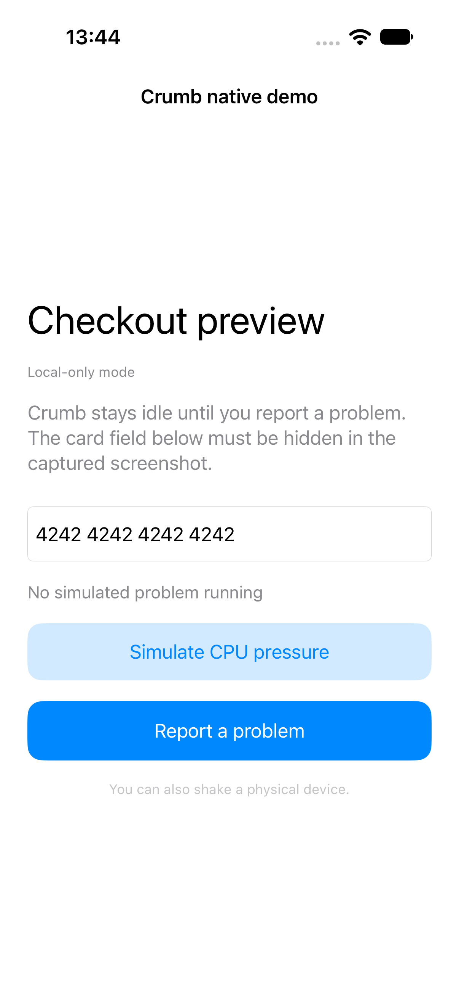

# Direct report completion evidence

Synthetic public fixtures for issue #68. Before: successful submission leaves the review screen behind a Report saved popup. After: the reporter closes as soon as the durable queue commit succeeds and returns to the demo host.

| Before | After |
| --- | --- |
|  |  |

Captured on a disposable iPhone 18 Pro simulator, iOS 27.0, with default local-only configuration. Report text and the demo card number are synthetic fixtures. No real report contents, credentials, endpoints, or live uploads are present.

The after capture comes from `testSuccessfulSubmissionReturnsToHostWithoutConfirmation`. It submits a report, waits for the reporter to disappear, verifies the saved popup is absent and the host is usable, then opens the reporter again. The Android submission UI check verifies the same behavior on API 26.

The installed Xcode 27.1 SDK requires a scene lifecycle when running on iOS 27. An uncommitted scene-window adapter was used for the local demo before and after. It only creates the demo host window and is excluded from this PR; SDK submission paths are unchanged by that harness.
