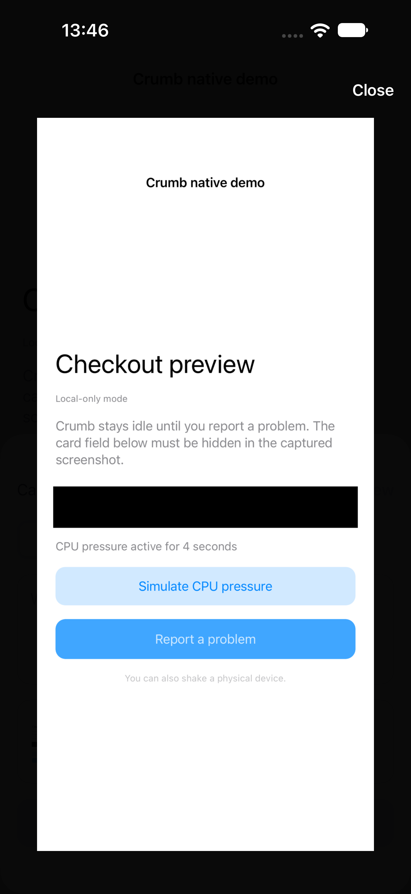
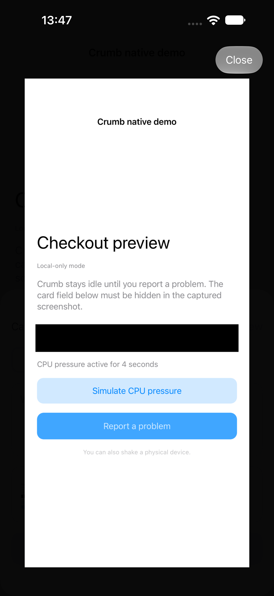
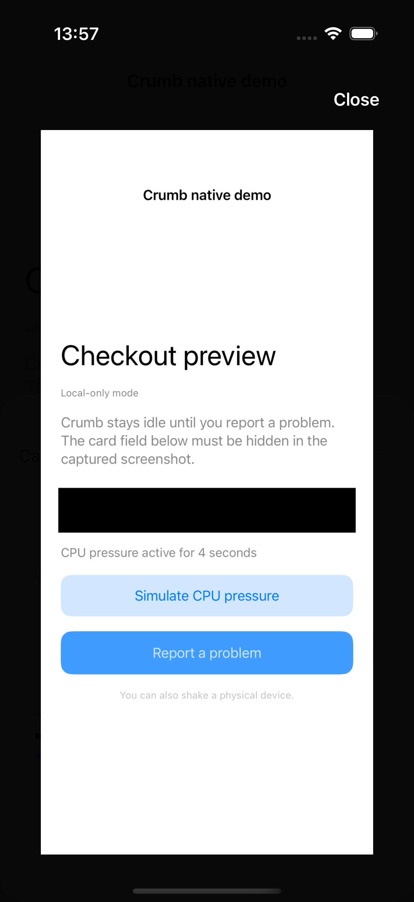
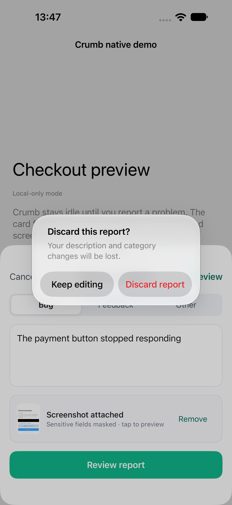

# iOS popup Liquid Glass evidence

These public visual fixtures were explicitly requested for issue #65. They use
only the disposable native demo, its fixed synthetic card value, and a synthetic
report description. The captured screenshot masks the demo text input. No user
attachments, real reports, credentials, or hosted service configuration are included.

## Visible change

The screenshot viewer now uses UIKit's native glass button configuration for its
Close control on iOS 26 and newer when built with a supported SDK. The existing
plain white control remains on older iOS. Reduce Transparency and a host's design
compatibility opt-out select the plain control; Reduce Transparency also makes
the viewer backdrop opaque.

Standard alerts remain unmodified `UIAlertController` instances. They already
receive the current native material from UIKit; this change does not replace or
wrap system alerts. See Apple's [Liquid Glass adoption guidance](https://developer.apple.com/documentation/technologyoverviews/adopting-liquid-glass).

| iOS 27 before | iOS 27 after | iOS 18.6 fallback |
| --- | --- | --- |
|  |  |  |

The native discard alert was also opened and its Keep editing action verified:

## Verification

- Xcode 27.1; iPhone 18 Pro Max simulator running iOS 27.0 and iPhone 16 Pro
  simulator running iOS 18.6.
- `npm ci`, `npm run contracts:check`, and `npm run test:ios` passed; all 49 Swift
  tests passed.
- A generic iOS Simulator build and `build-for-testing` passed with code signing
  disabled and the iOS 15 deployment target preserved.
- Existing `testCreatesLocalReportDraft` passed before/after on iOS 27.0 and after
  on iOS 18.6. Temporary screenshot attachments exercised opening the viewer,
  closing it, typing a synthetic report, opening the native discard alert,
  keeping the draft, and reaching review.
- The iOS 27 disposable demo used a temporary scene-lifecycle harness required by
  the current simulator. That harness and screenshot instrumentation were restored
  before commit; the production SDK changes were the code used in the after captures.
- Live Reduce Transparency toggling was not verified: simulator preference and
  Settings automation did not produce a reliable enabled state. Those setup
  captures are excluded. The availability fallback is verified on real iOS 18.6
  simulator execution, and the Reduce Transparency guard remains a review gate.
