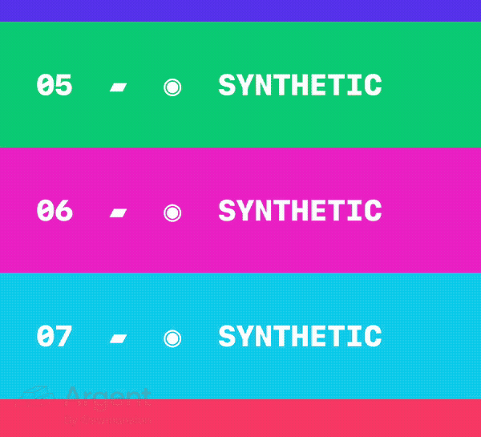
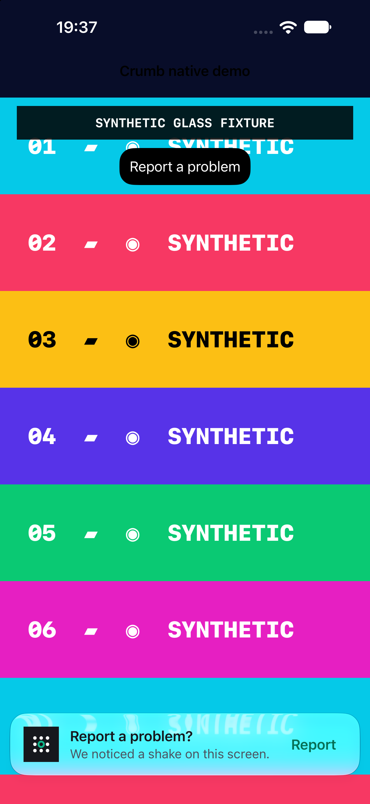
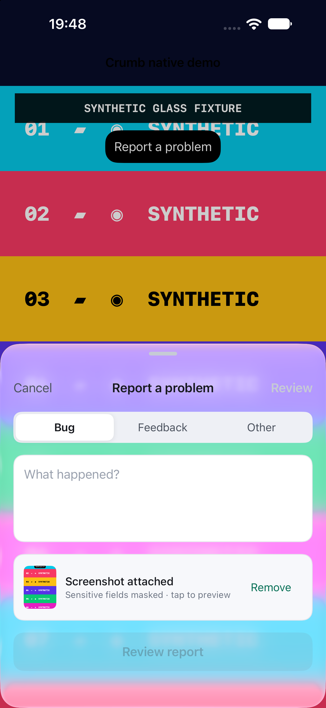
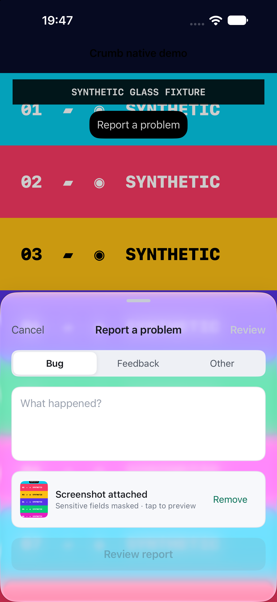
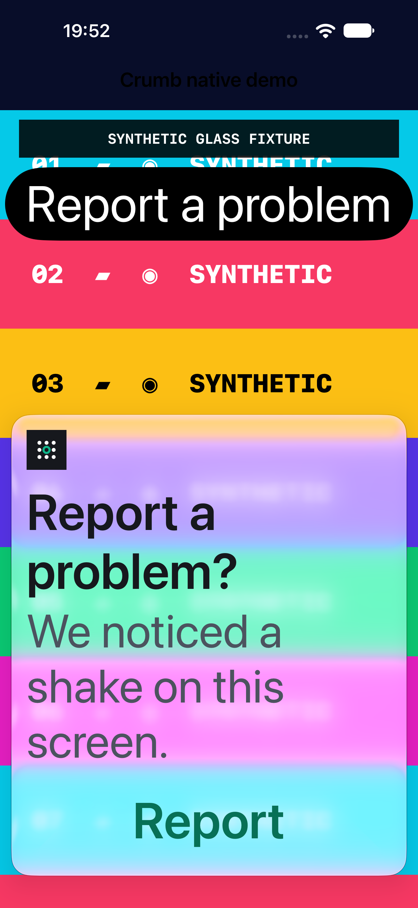
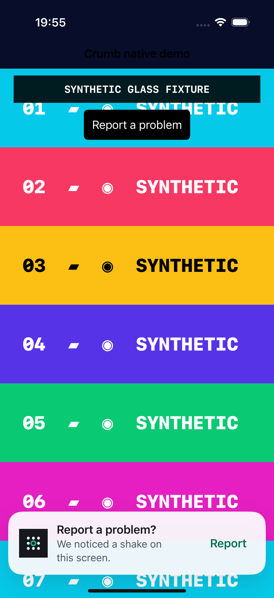

# Report sheet and shake prompt Liquid Glass evidence

These sanitized public visual fixtures were explicitly requested for issue #67.
They show only the disposable native demo, whose fixed sample card value is
synthetic. The user-provided screenshots and real report data are not included.

## Visible change

The custom report composer panel and shake prompt now use a native
`UIGlassEffect(style: .regular)` background on iOS 26 and newer when built with
a supporting SDK. The native corner configuration follows each surface’s rounded shape.
The prompt hosts its text and Report button inside the native effect’s `contentView`.
The composer keeps its input cards, keyboard layout, and screenshot capture behavior.

On older iOS, the original canvas surface is retained. Reduce Transparency also
selects an opaque surface, and the host's design compatibility opt-out is honored.
The material observes the system accessibility setting notification.

Native API behavior was checked against the installed UIKit SDK and Apple's
[UIGlassEffect documentation](https://developer.apple.com/documentation/uikit/uiglasseffect)
and [Liquid Glass adoption guidance](https://developer.apple.com/documentation/technologyoverviews/adopting-liquid-glass).

| Surface | Main before this PR | Corrected iOS 27 appearance | iOS 18.6 fallback |
| --- | --- | --- | --- |
| Report composer |  |  |  |
| Shake prompt |  |  |  |

## Visual review correction

The original white-on-white capture did not demonstrate translucency. Runtime
inspection confirms that the original PR already used `UIGlassEffect`; this
correction fixes native content containment, corner handling, and interaction.

- Prompt text and Report now live in `UIVisualEffectView.contentView`.
- Native `cornerConfiguration` defines the glass shape. The native material draws
  its edge and depth without the legacy card shadow or ancestor clipping.
- The prompt enables native interactive glass response.
- Auto Layout connects the content to the outer surface for content-driven height.
- The no-effect fallback keeps its content container visible and interactive.

[Full-screen native recording](native-glass-motion.mp4) shows numbered content
moving behind the stationary prompt, followed by an actual 0.4-second Report
press and the composer transition. The inline detail below is a spatial crop
and encode of that recording; it contains no generated or added glass effects.

Both captures below use the same saturated, numbered synthetic host. The before
capture uses original PR head `3ffb8f6`; the after uses the corrected SDK source.
The visible refraction exists in both: the comparison is not a claim that the
original implementation had no glass.

| Before correction | Corrected native container |
| --- | --- |
|  |  |

| Composer before correction | Corrected composer |
| --- | --- |
|  |  |

The composer remains a glass background with its controls in their existing
layers; the prompt's controls are hosted inside the native content container.

[Runtime evidence](review-runtime.json) reports iOS 27.0, Reduce Transparency off,
no compatibility opt-out, `UIGlassEffect`, interactive material, and a `UIStackView`
inside its content container. The native corner configuration owns its rounding;
its CALayer corner radius need not report the same radius.

Apple’s [UIKit adoption guidance](https://developer.apple.com/videos/play/wwdc2025/284/)
shows the content-container and native corner pattern. The adaptable `.regular`
variant remains appropriate for this text-bearing surface; see Apple’s
[materials guidance](https://developer.apple.com/design/human-interface-guidelines/materials).

## Large text

At the actual system accessibility XXXL category, the prompt uses a vertical
layout with full-width text and Report. The full title fits at 53 points, the
485-point surface is entirely on-screen in the verified portrait layout, and pressing Report opens the composer.
Normal text sizes keep the compact horizontal prompt. This layout also updates
when the content-size category changes.

[Large-text runtime evidence](review-large-text-runtime.json) records the actual
category, font size, full-title fit, and surface/action frames. The native effect
and content-container checks passed. Default-size recording/matrix captures show
the material correction; the accessibility layout was verified separately.

## Fallback action check

The final source also ran on iOS 18.6: the no-effect content container remained
visible, and a real 0.4-second Report press opened the composer. The white-screen
fallback images above were refreshed from this run. The same numbered host is
shown below for comparison with native glass.

[Fallback runtime evidence](review-fallback-runtime.json) records a nil effect
and the visible content stack. The temporary fixture/scene/diagnostic code is
not included in the SDK source.

## Verification

- Xcode 27.1; iPhone 18 Pro Max simulator running iOS 27.0 and iPhone 16 Pro
  simulator running iOS 18.6.
- `npm ci`, `npm run contracts:check`, and `npm run test:ios` passed; all 49 Swift
  tests passed.
- A generic iOS Simulator build and `build-for-testing` passed with code signing
  disabled. The iOS 15 deployment target is preserved, and native glass API
  references are also guarded from older Swift compilers/SDKs.
- Existing `testShakeShowsCompactConfirmationBeforeReporter` passed before and
  after on iOS 27.0 and after on iOS 18.6, verifying the compact prompt, its Report
  action, and the opened composer. Temporary screenshot attachments captured
  both states; all images were inspected.
- The iOS 27 disposable demo used temporary scene-lifecycle support required by
  the current simulator. The harness and screenshot instrumentation were restored
  before commit; the after captures used this PR's SDK source.
- Live Reduce Transparency toggling was not verified. Direct preference changes
  did not update UIKit reliably, and Settings automation did not achieve a
  reliable enabled state. Those setup captures are excluded. The older-iOS
  fallback was verified by actual iOS 18.6 execution; the accessibility guard and
  notification handling remain for reviewer assessment.
