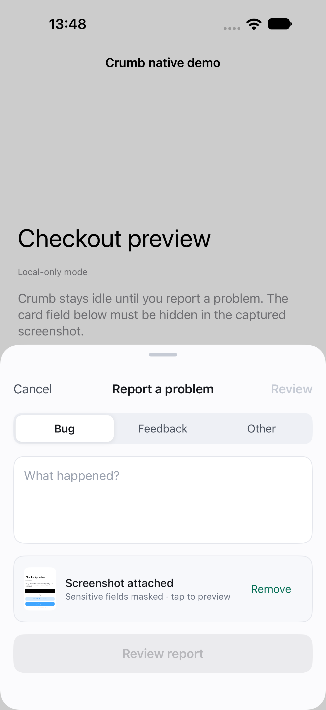
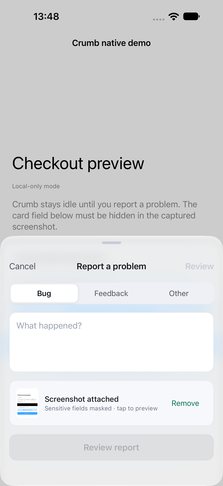
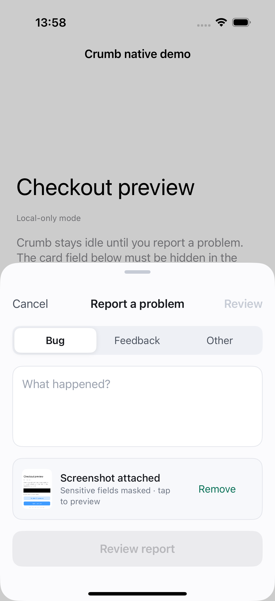
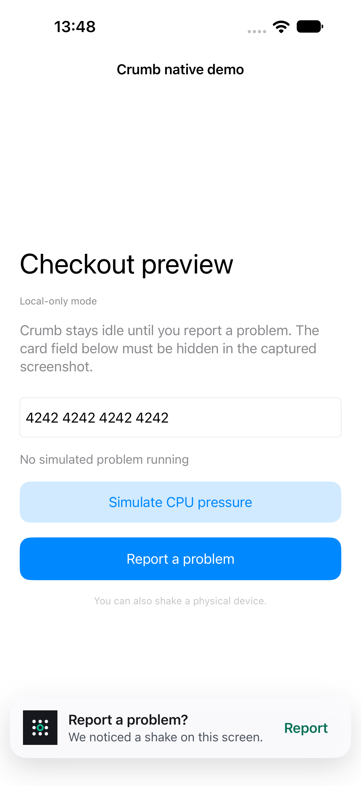
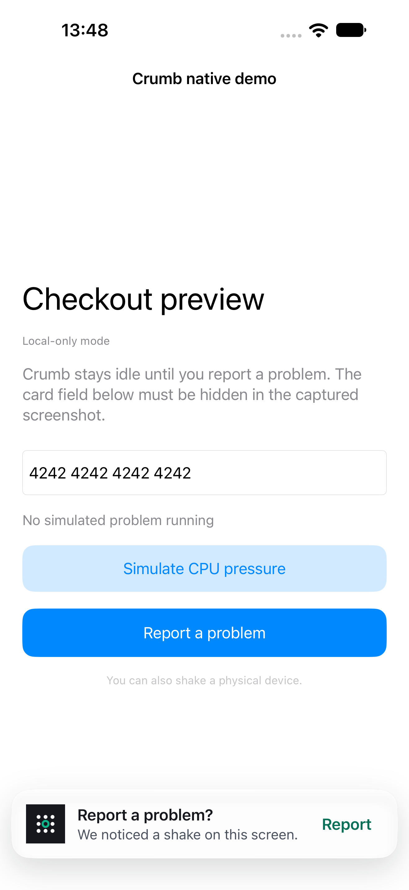
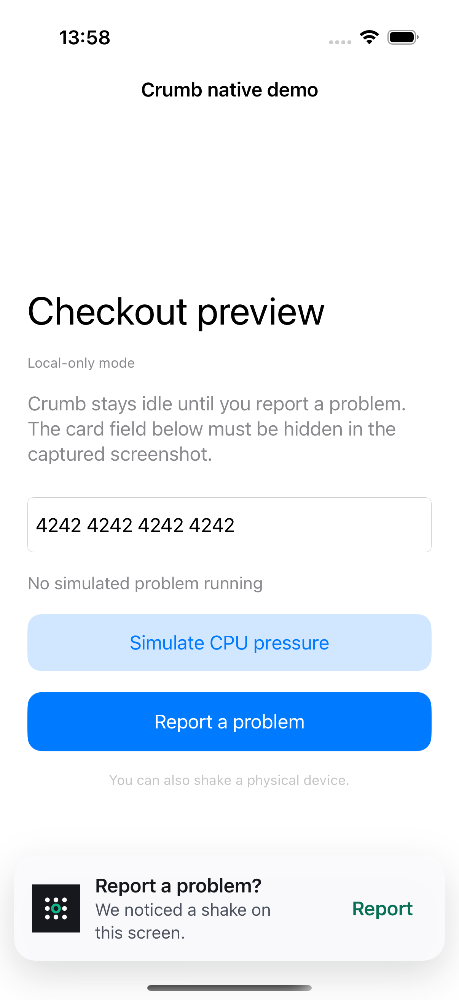

# Report sheet and shake prompt Liquid Glass evidence

These sanitized public visual fixtures were explicitly requested for issue #67.
They show only the disposable native demo, whose fixed sample card value is
synthetic. The user-provided screenshots and real report data are not included.

## Visible change

The custom report composer panel and shake prompt now use a native
`UIGlassEffect(style: .regular)` background on iOS 26 and newer when built with
a supporting SDK. Each material follows the existing surface's rounded corners.
The content, input cards, actions, keyboard layout, and screenshot capture remain
in their existing layers.

On older iOS, the original canvas surface is retained. Reduce Transparency also
selects an opaque surface, and the host's design compatibility opt-out is honored.
The material observes the system accessibility setting notification.

Native API behavior was checked against the installed UIKit SDK and Apple's
[UIGlassEffect documentation](https://developer.apple.com/documentation/uikit/uiglasseffect)
and [Liquid Glass adoption guidance](https://developer.apple.com/documentation/technologyoverviews/adopting-liquid-glass).

| Surface | iOS 27 before | iOS 27 after | iOS 18.6 fallback |
| --- | --- | --- | --- |
| Report composer |  |  |  |
| Shake prompt |  |  |  |

## Verification

- Xcode 27.1; iPhone 18 Pro Max simulator running iOS 27.0 and iPhone 16 Pro
  simulator running iOS 18.6.
- `npm ci`, `npm run contracts:check`, and `npm run test:ios` passed; all 49 Swift
  tests passed.
- A generic iOS Simulator build and `build-for-testing` passed with code signing
  disabled. The iOS 15 deployment target is preserved, and native glass API
  references are also guarded from older Swift compilers/SDKs.
- Existing `testShakeShowsCompactConfirmationBeforeReporter` passed before and
  after on iOS 27.0 and after on iOS 18.6, verifying the compact prompt, its Report
  action, and the opened composer. Temporary screenshot attachments captured
  both states; all images were inspected.
- The iOS 27 disposable demo used temporary scene-lifecycle support required by
  the current simulator. The harness and screenshot instrumentation were restored
  before commit; the after captures used this PR's SDK source.
- Live Reduce Transparency toggling was not verified. Direct preference changes
  did not update UIKit reliably, and Settings automation did not achieve a
  reliable enabled state. Those setup captures are excluded. The older-iOS
  fallback was verified by actual iOS 18.6 execution; the accessibility guard and
  notification handling remain for reviewer assessment.
